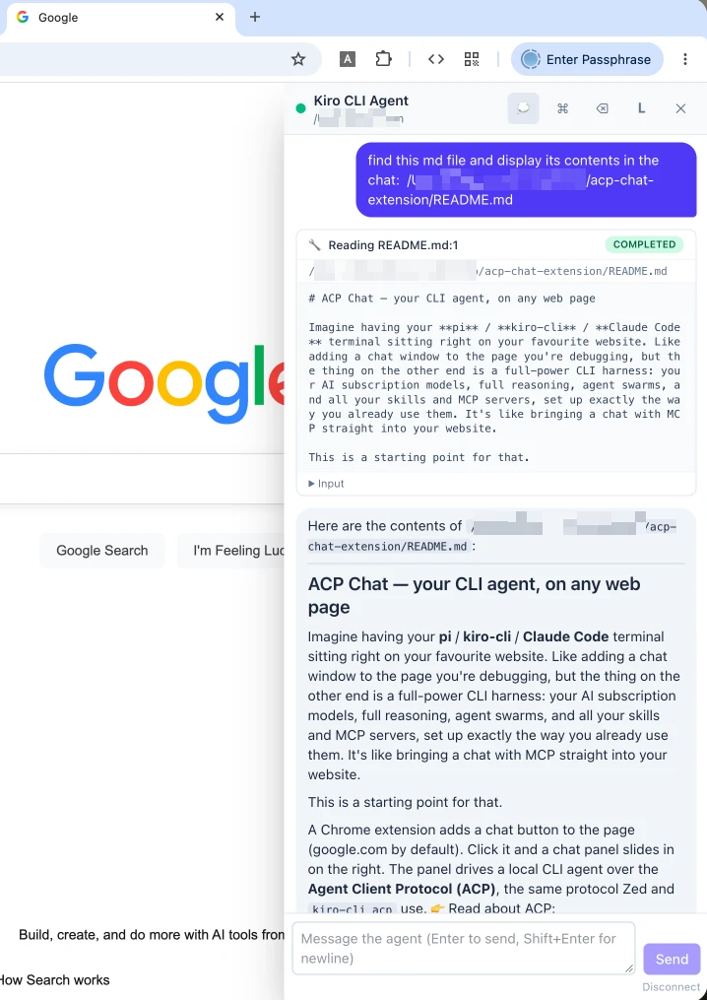
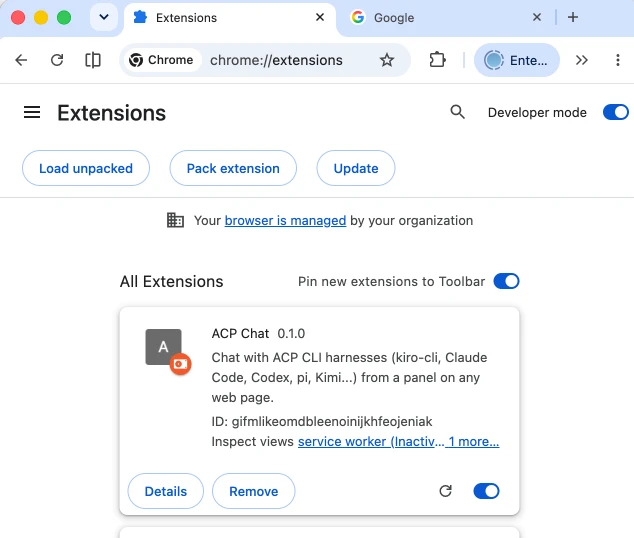

# ACP Chat — your CLI agent, on any web page

Imagine having your **pi** / **kiro-cli** / **Claude Code** terminal sitting right on your favourite website. Like adding a chat window to the page you're debugging, but the thing on the other end is a full-power CLI harness: your AI subscription models, full reasoning, agent swarms, and all your skills and MCP servers, set up exactly the way you already use them. It's like bringing a chat with MCP straight into your website.

This is a starting point for that.

A Chrome extension adds a chat button to the page (google.com by default). Click it and a chat panel slides in on the right. The panel drives a local CLI agent over the **Agent Client Protocol (ACP)**, the same protocol Zed and `kiro-cli acp` use. 👉 Read about ACP: **https://agentclientprotocol.com**

The agent runs on your machine, so it can read and write your files, run commands and coordinate sub-agents. The browser only renders the conversation.  It's a basic 'remoting' the terminal, rendered in html inside your fav page.

## Preview



## How it works

```
 ┌──────────────────────── Chrome ────────────────────────┐
 │  google.com tab                                        │
 │  ┌──────────────┐   ┌────────────────────────────────┐ │
 │  │ content.js   │──▶│ panel.html (iframe, ext origin)│ │
 │  │ 💬 button +  │   │ Alpine.js (CSP) + Tailwind     │ │
 │  │ S/M/L frame  │◀──│ markdown → DOM (no innerHTML)  │ │
 │  └──────────────┘   └───────────────┬────────────────┘ │
 │                     chrome.runtime port                │
 │                    ┌────────────────▼───────────────┐  │
 │                    │ background.js (service worker) │  │
 │                    │ ACP client · JSON-RPC 2.0      │  │
 │                    │ transcript · permissions       │  │
 │                    └────────────────┬───────────────┘  │
 └─────────────────────────────────────┼──────────────────┘
                 native messaging (4-byte length + JSON)
                    ┌─────────────────▼───────────────┐
                    │ host/host.js (Node, no deps)    │
                    │ spawns a harness from config    │
                    └─────────────────┬───────────────┘
                     stdio (newline-delimited JSON-RPC)
                    ┌─────────────────▼───────────────┐
                    │ kiro-cli acp · claude-agent-acp │
                    │ codex-acp · pi-acp · kimi acp   │
                    └─────────────────────────────────┘
```

- **Service worker**: 
  - decodes ACP: `initialize` → `session/new` → `session/prompt`.
  - It streams `session/update` (message/thought chunks, tool calls, plans) and 
  - answers `session/request_permission` from your clicks. 
  - It owns the session, so the chat survives page navigation.
- **Native host**: a dumb pipe to your host (kiro-cli, codex, pi, Claude-code, etc). The browser can only pick a harness **by id**; commands live in a local config file.
- **Panel**: chat UI. The button cycles **S** (360×480) → **M** (440×720, default) → **L** (full height, 40% width, docked right). Esc closes.

## Quick start

```bash
npm install
npm run build          # vendors Alpine CSP build + compiles Tailwind
npm run install-host   # registers the native host (macOS/Linux)
```

1. Open `chrome://extensions`, turn on Developer mode, click **Load unpacked** and choose `extension/`.
   The id is fixed by the manifest key: `gifmlikeomdbleenoinijkhfeojeniak`.
   
   

2. Go to https://www.google.com, click 💬, pick a harness and click **Connect**.

3. On any other site, click the toolbar icon to add the panel to that tab.

Try **Mock agent (offline demo)** first; it needs no login or network.

## Harnesses

Edit `host/harnesses.json`, or copy it to `~/.config/acp-chat/harnesses.json` (or set `ACP_CHAT_CONFIG`):

```json
{ "id": "kiro", "name": "Kiro CLI", "command": "kiro-cli", "args": ["acp"] }
```

| id     | command                                                         |
| ------ | --------------------------------------------------------------- |
| kiro   | `kiro-cli acp`                                                  |
| claude | `npx -y @agentclientprotocol/claude-agent-acp`                  |
| codex  | `npx -y @agentclientprotocol/codex-acp`                         |
| pi     | `npx -y pi-acp`                                                 |
| kimi   | `kimi acp`                                                      |
| gemini | `gemini --experimental-acp` (the flag differs between versions) |

Log in to each CLI in a normal terminal first; ACP sessions reuse that login. `install-host` captures your current `PATH`, so re-run it if a harness moves.

## Remote agents (ACP over HTTP, no native host)

Pick **pipool (remote)** in the harness list and fill in the server URL, API key and (optionally) a session id. The service worker then talks ACP directly to `POST <url>/acp` (JSON-RPC per POST, streamed back as SSE; see [pipool](https://github.com/wallabyway/piPool)). Nothing needs to be installed except the extension, so any computer can join.

- Blank session id → `session/new` (a fresh agent). The id is saved; **Connect** again resumes it with `session/load`. Paste the same id on another computer to continue the conversation there. **＋** clears it for a new session.
- Chrome asks for host access to the server's origin on first connect (`127.0.0.1`/`localhost` are pre-granted).
- `node test/remote-acp.mjs http://127.0.0.1:18081 <key>` runs an end-to-end check of the client against a live server.

## Markdown

It's not a strong markdown renderer, but it does the basics: headings, paragraphs, **bold**/*italic*/~~strike~~, `inline code`, fenced code blocks, lists, quotes, rules and links. It builds DOM nodes directly and never uses `innerHTML`. Only `http(s)` and `mailto` links are allowed. Raw HTML from the agent is shown as text.

## Security notes

- Whatever the agent can do, it does as **you**, on your machine. Use the permission prompts.
- Native host access is limited to this extension id (`allowed_origins`). Commands and arguments are never taken from the browser.
- Panel ⇄ page control uses `chrome.tabs.sendMessage`, not `postMessage`, so the host page can't drive the chat. `panel.html` is exposed with `use_dynamic_url`.
- The extension advertises no `fs`/`terminal` client capabilities. Harnesses use their own built-in tools.

## Development

```bash
npm run build       # vendor Alpine CSP build + compile Tailwind into extension/
npm run watch:css   # rebuild Tailwind while editing panel.html
```

After editing extension files, click reload on the extension in `chrome://extensions`. Use the **Mock agent** harness (`host/mock-agent.mjs`) to try UI changes without a real model. Prompts containing "tool" trigger a plan, a tool call and a permission request; prompts containing "slow" stream slowly so you can test Stop.

## Not done yet / ideas

Mode and model pickers (`session/new` already returns `modes`). `session/load` to resume sessions. Slash-command autocomplete (`available_commands_update` is already tracked). Image paste. A domain allowlist in an options page. Windows host registration (registry).
